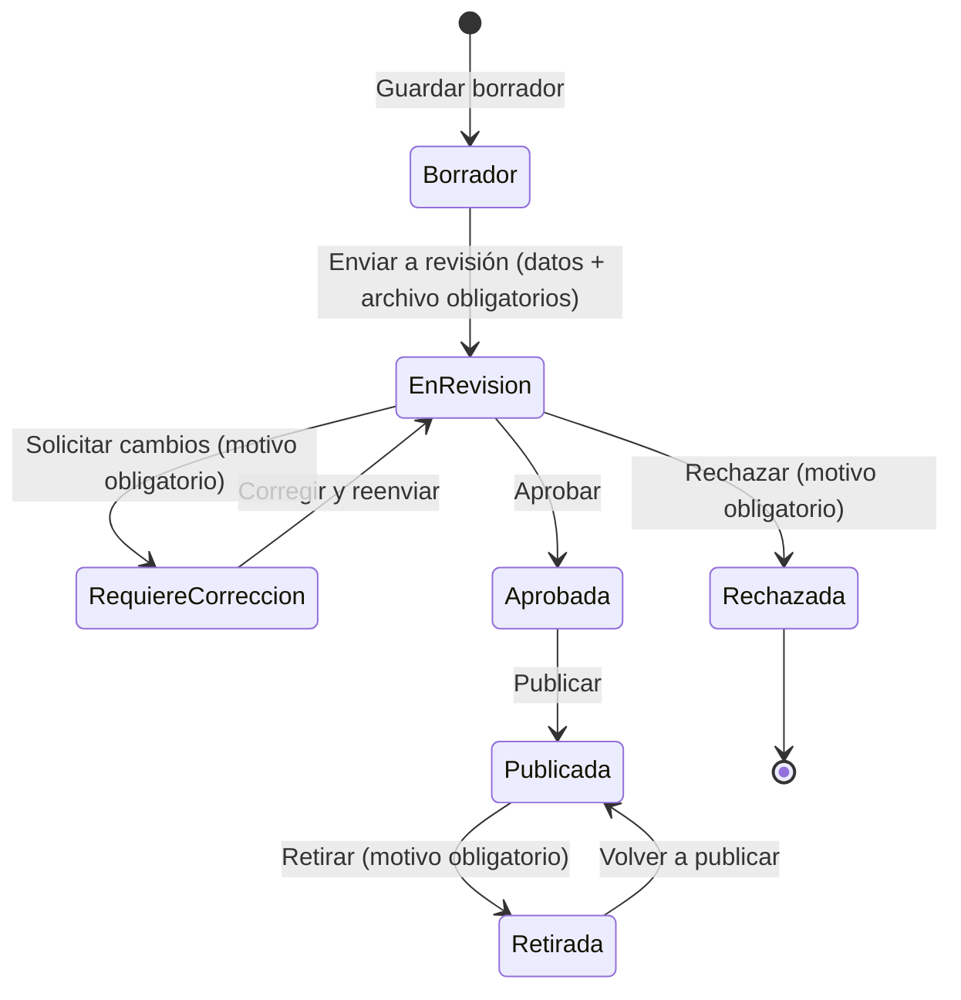

# Documentación de implementación · Idearia

Evaluación Sumativa N.º 3 · Proyecto Integrado · INACAP
Versión 1.0 · Noviembre 2026

Este documento explica cómo se construyó Idearia a partir del diseño de la Evaluación 2 (UML 4+1, mockups, modelo de datos y matriz de permisos): qué se implementó, dónde está cada parte y por qué se tomó cada decisión.

---

## 1. Arquitectura

Idearia es una aplicación **monolítica Django** con el patrón **MVT** (Modelo, Vista, Template):

```
Navegador ──HTTPS──> Django (vistas + formularios + permisos) ──ORM──> PostgreSQL (Supabase)
                          │
                          └──> media_protegida/ (planificaciones y certificados, sin URL pública)
```

Cada **componente del diagrama de componentes de la Evaluación 2** corresponde a una aplicación Django:

| Componente (Evaluación 2) | App Django | Responsabilidad |
|---|---|---|
| Autenticación · Gestión de usuarios | `usuarios` | Modelo `Usuario` con rol, registro, login/logout, decoradores de permisos, activar y desactivar cuentas |
| Solicitudes de colaborador | `colaboradores` | `SolicitudColaborador`, envío y revisión de la acreditación |
| Catálogo y búsqueda · Carga y revisión de planificaciones | `planificaciones` | `Planificacion` y catálogos, búsqueda y filtros, visor, propuestas del colaborador, revisión del administrador |
| Comentarios, valoraciones y favoritos | `interacciones` | `Favorito`, `Valoracion`, `Comentario` |
| Servicio de notificaciones | `notificaciones` | `Notificacion` y funciones `notificar()` |
| Transversal | `core` | Inicio, panel admin, auditoría (`RegistroAccion`), validación de archivos, cabeceras de seguridad |

Las vistas son **funciones** (no clases) para que cada paso sea fácil de leer y explicar. La excepción son el login y el logout, que reutilizan las vistas seguras de Django.

## 2. Modelo de datos

### 2.1 Diagrama entidad-relación

```mermaid
erDiagram
    USUARIO ||--o{ SOLICITUD_COLABORADOR : "solicita"
    USUARIO ||--o{ PLANIFICACION : "aporta (colaborador)"
    USUARIO ||--o{ FAVORITO : "guarda"
    USUARIO ||--o{ VALORACION : "valora"
    USUARIO ||--o{ COMENTARIO : "comenta"
    USUARIO ||--o{ NOTIFICACION : "recibe"
    USUARIO ||--o{ REGISTRO_ACCION : "realiza"
    PLANIFICACION ||--o{ FAVORITO : ""
    PLANIFICACION ||--o{ VALORACION : ""
    PLANIFICACION ||--o{ COMENTARIO : ""
    PLANIFICACION ||--o{ PLANIFICACION_CATEGORIA : ""
    CATEGORIA ||--o{ PLANIFICACION_CATEGORIA : ""
    PLANIFICACION }o--o{ MATERIAL : "requiere"
    NUCLEO ||--o{ PLANIFICACION : "clasifica"
    AMBITO ||--o{ NUCLEO : "agrupa"

    USUARIO { bigint id PK; varchar email UK; varchar rut UK; varchar rol; bool is_active; varchar password "hash PBKDF2" }
    SOLICITUD_COLABORADOR { bigint id PK; bigint usuario_id FK; varchar titulo_profesional; varchar institucion; smallint anio_titulacion; varchar documento_respaldo; varchar estado; bigint revisado_por_id FK }
    PLANIFICACION { bigint id PK; bigint colaborador_id FK; varchar titulo; varchar nivel_educativo; varchar edad_recomendada; bigint nucleo_id FK; smallint duracion_minutos; varchar archivo; varchar estado; datetime fecha_publicacion }
    VALORACION { bigint id PK; bigint usuario_id FK; bigint planificacion_id FK; smallint puntuacion "CHECK 1-5" }
    FAVORITO { bigint id PK; bigint usuario_id FK; bigint planificacion_id FK }
    COMENTARIO { bigint id PK; bigint usuario_id FK; bigint planificacion_id FK; text contenido; varchar estado }
```

### 2.2 Tablas

| Tabla (Django) | Entidad de la Evaluación 2 | Propósito |
|---|---|---|
| `usuarios_usuario` | usuarios | Una sola tabla de usuarios con el campo `rol` |
| `colaboradores_solicitudcolaborador` | solicitudes_colaborador | Acreditación profesional |
| `planificaciones_planificacion` | planificaciones | Idea pedagógica + archivo Word/PDF + estado de revisión |
| `planificaciones_categoria` y `planificaciones_planificacioncategoria` | categorias, planificaciones_categorias | Temáticas (muchos a muchos) |
| `planificaciones_ambito` y `planificaciones_nucleo` | *(nuevo)* | Catálogo de las Bases Curriculares |
| `planificaciones_material` y `planificaciones_planificacion_materiales` | *(nuevo)* | Materiales requeridos (muchos a muchos) |
| `interacciones_favorito`, `interacciones_valoracion`, `interacciones_comentario` | favoritos, valoraciones, comentarios | Interacciones |
| `notificaciones_notificacion` | notificaciones | Avisos internos |
| `core_registroaccion` | *(nuevo)* | Auditoría de acciones administrativas (RNF-11) |

### 2.3 Cambios respecto del modelo de la Evaluación 2 y su justificación

| Cambio | Motivo |
|---|---|
| `Usuario` hereda de `AbstractUser` | Se reutiliza la autenticación segura de Django (hash de contraseñas, sesiones). Se usa **una tabla** con `rol` en lugar de tres, porque los perfiles comparten casi todos los datos. Se inicia sesión con correo (`USERNAME_FIELD = "email"`). |
| `contrasena` pasa a `password`, `estado` pasa a `is_active` | Son los campos estándar de Django. `password` guarda el hash, nunca el texto. |
| `ambito_nucleo` (texto) pasa a FK a `Nucleo`, que pertenece a `Ambito` | Normalización (sin texto repetido) y filtros exactos por ámbito o núcleo. |
| `duracion` (texto) pasa a `duracion_minutos` (entero con opciones) | Permite filtrar por rangos (<30, 30–60, >60 minutos). |
| `materiales` (texto) pasa a tabla `Material` (muchos a muchos) | RF-03 exige filtrar por materiales. |
| Se agregan `observacion_revision`, `revisado_por`, `fecha_envio` | Estaban en el diagrama de clases. Permiten la retroalimentación (RF-16/17) y la trazabilidad. |
| `SolicitudColaborador` no repite RUT ni nombre | Se obtienen del usuario relacionado (3FN). Se agregó `anio_titulacion`. |
| Clase `TituloProfesional` del diagrama de clases | El archivo vive en la propia solicitud (`documento_respaldo`), como en el modelo de datos de la Evaluación 2. |
| Nueva `RegistroAccion` | Requisito de seguridad RNF-11 (quién, qué, cuándo, IP). |

### 2.4 Restricciones e índices

| Restricción | Tabla | Qué impide |
|---|---|---|
| `UNIQUE(usuario, planificacion)` (`favorito_unico_por_usuario`) | favorito | Favorito duplicado |
| `UNIQUE(usuario, planificacion)` (`valoracion_unica_por_usuario`) | valoracion | Doble valoración |
| `CHECK(puntuacion BETWEEN 1 AND 5)` | valoracion | Puntuaciones fuera de rango, aun insertando directo en la BD |
| `UNIQUE(usuario) WHERE estado IN ('PENDIENTE','EN_REVISION')` (índice parcial) | solicitud | Dos solicitudes activas del mismo usuario |
| `UNIQUE(ambito, nombre)`, `UNIQUE(planificacion, categoria)` | nucleo, planificacioncategoria | Datos repetidos en catálogos |
| `UNIQUE(email)`, `UNIQUE(rut)` | usuario | Cuentas duplicadas |
| FK `PROTECT` en `colaborador` y `nucleo` | planificacion | Borrar un autor o núcleo y dejar propuestas huérfanas |

| Índice | Columnas | Consulta que acelera |
|---|---|---|
| `planif_estado_fecha_idx` | `estado, fecha_publicacion DESC` | Catálogo de publicadas ordenado por fecha (la consulta más frecuente) |
| `planif_nivel_edad_idx` | `nivel_educativo, edad_recomendada` | Filtros del Educador |
| `planif_duracion_idx` | `duracion_minutos` | Filtro por duración |
| `notif_usuario_leida_idx` | `usuario, leida` | Contador de no leídas (en cada página) |
| Índices simples | `rol`, `estado` (solicitudes y planificaciones), `fecha_solicitud`, `fecha_comentario`, `accion` y `fecha` de auditoría | Listados y filtros administrativos |

Django crea además un índice por cada clave foránea.

## 3. Migraciones

- Hay **una migración inicial por app** (`0001_initial.py`), generada en orden de dependencias para que sea fácil de leer.
- `planificaciones/0002_catalogos_iniciales.py` es una **migración de datos** (`RunPython`). Carga 3 ámbitos, 8 núcleos, 10 categorías y 16 materiales. Así, `migrate` en Supabase deja los catálogos listos.
- Las migraciones se probaron en **SQLite** y en **PostgreSQL 15** (evidencia en `docs/evidencias/integracion_postgresql.txt`).

## 4. Conexión con Supabase

Solo se adaptó la sección `DATABASES` de `config/settings.py` y la carga de `.env` con `python-dotenv`:

- `DB_ENGINE="sqlite"`: archivo local `db.sqlite3`, para desarrollar sin internet.
- `DB_ENGINE="supabase"`: `django.db.backends.postgresql` con `DB_HOST`, `DB_PORT`, `DB_NAME`, `DB_USER`, `DB_PASSWORD` y `sslmode=require`.
- Si falta algún dato, Django muestra un error claro (`ImproperlyConfigured`) en lugar de intentar conectarse.
- `CONN_MAX_AGE=0` (configurable): con el *Session pooler* de Supabase es preferible no retener conexiones.

Los pasos para configurar y verificar están en el README.

## 5. Autenticación

| Aspecto | Implementación |
|---|---|
| Registro | `RegistroForm` (extiende `UserCreationForm`). Valida RUT (módulo 11), correo único sin distinguir mayúsculas, edad mínima de 18 años y contraseña según los validadores de Django. **El rol siempre es Educador/a**: no se lee del formulario, lo que evita el escalamiento de privilegios. |
| Inicio de sesión | `LoginView` de Django con `LoginForm` (correo + contraseña). El mensaje de error es genérico: no revela si el correo existe. |
| Bloqueo por intentos | Tras **5 intentos fallidos** (mismo correo + IP) se bloquea por 15 minutos (`cache`). |
| Contraseñas | Hash PBKDF2-SHA256 de Django. Nunca se guardan en texto plano. |
| Cierre de sesión | Solo por **POST** con token CSRF. |
| Sesión | Cookie `HttpOnly`, duración de 8 horas. En producción, `Secure`. |
| Cuenta desactivada | `is_active=False`: Django rechaza el login y la sesión existente deja de ser válida. |
| Registro en log | Cada inicio de sesión exitoso y fallido queda en `logs/idearia.log` (`usuarios/senales.py`). |

## 6. Autorización (control por rol)

`usuarios/permisos.py` define el decorador `rol_requerido(*roles)`:

- Sin sesión: redirige al login.
- Con sesión, pero sin el rol: **403 Prohibido** (página propia, sin datos técnicos).

```python
@administrador_requerido      # = rol_requerido(Usuario.Rol.ADMINISTRADOR)
@require_POST
def accion_revision(request, pk): ...
```

Además de comprobar el rol, las vistas filtran por **propiedad**. Por ejemplo, `get_object_or_404(Planificacion, pk=pk, colaborador=request.user)` impide que un colaborador edite propuestas ajenas (IDOR). Las ideas no publicadas responden **404** a quien no es su autor ni administrador, así no se revela que existen.

### Matriz de permisos implementada

| Funcionalidad | Educador/a | Colaborador/a | Administrador/a |
|---|:-:|:-:|:-:|
| Buscar, ver detalle y ver la planificación | Sí | Sí | Sí |
| Descargar la planificación | No | No | No |
| Favoritos, valorar, comentar | Sí | Sí ¹ | No |
| Solicitar acreditación | Sí | No (ya acreditado) | No |
| Crear, editar y enviar propuestas | No | Sí | No |
| Revisar, aprobar, rechazar, publicar y retirar | No | No | Sí |
| Revisar solicitudes de colaborador | No | No | Sí |
| Gestionar usuarios, moderar comentarios, ver auditoría | No | No | Sí |

¹ **Cambio respecto de la Evaluación 2:** el Colaborador/a es una Educadora acreditada, por lo que conserva sus funciones de Educador/a. No puede valorar su propia propuesta.

## 7. Flujos de estado

**Propuesta pedagógica** (`Planificacion.ACCIONES_REVISION` en `planificaciones/models.py`):



- Solo `Publicada` aparece en el catálogo (RF-16).
- `Rechazada` es definitiva; para corregir se usa `Requiere corrección`.
- Cualquier transición no listada lanza `TransicionInvalida` y se muestra un mensaje de error.

**Solicitud de colaborador:** `Pendiente → En revisión → Aprobada | Rechazada`. También se puede resolver directamente desde `Pendiente`. Al aprobar, `usuario.rol = COLABORADOR`. Una solicitud procesada no admite una segunda decisión.

Cada decisión del administrador **notifica** al usuario (`notificaciones.servicios.notificar`) y queda **auditada** (`core.auditoria.registrar_accion`).

## 8. Gestión de archivos

| Medida | Dónde |
|---|---|
| Formatos: planificación **PDF y DOCX**; acreditación **PDF, JPG y PNG** | `core/validators.py` |
| Validación de **extensión**, **tamaño** (vacío y máximo 10 MB), **MIME** declarado y **firma real** (primeros bytes: `%PDF-`, ZIP, PNG, JPEG) | `validar_archivo()` |
| DOCX: debe contener `word/document.xml` y se rechaza si tiene macros (`vbaProject.bin`) | `validar_archivo()` |
| Nombre en disco **aleatorio** (`uuid4`); el nombre original se guarda aparte | `ruta_planificacion()`, `ruta_acreditacion()` |
| Carpeta `media_protegida/` **sin URL pública** (no hay `MEDIA_URL` en `urls.py`) | `settings.py` |
| Entrega solo mediante vistas que comprueban sesión y permiso | `planificaciones/views.py: documento_pdf`, `colaboradores/views.py: documento` |
| Los archivos **nunca se ejecutan**: se leen como bytes. El DOCX se convierte a HTML con `mammoth` y se limpia (sin scripts, eventos ni enlaces no web) | `planificaciones/visor.py` |
| Al reemplazar un archivo, se elimina el anterior | `views_colaborador._guardar_propuesta` |

**Visualización sin descarga (RF-06).** El PDF se dibuja con **PDF.js** en `<canvas>`, sin la barra del visor del navegador. El servidor solo entrega los bytes si la petición trae la cabecera `X-Idearia-Visor`: abrir la URL directamente devuelve 403. La respuesta usa `Content-Disposition: inline` y `Cache-Control: no-store`. También hay una marca de agua con el correo del usuario, el menú contextual, copiar y arrastrar están bloqueados, y la impresión está oculta.

> Limitación reconocida: ninguna técnica web impide al 100 % una captura de pantalla. Estas medidas **disminuyen y desincentivan** la distribución directa, como se planteó en la Evaluación 2.

## 9. Interfaces

Se conserva la línea visual de los mockups: paleta pastel (azul, menta, lila, durazno), tarjetas redondeadas, filtros laterales, chips de filtros activos y badges de estado. No se usan ilustraciones infantiles. El diseño es *responsive* (probado en 1366 px y 390 px).

| # | Pantalla | URL | Plantilla | Evidencia |
|---|---|---|---|---|
| 1 | Login | `/ingresar/` | `usuarios/login.html` | `capturas/01_login.png` |
| 2 | Registro | `/registro/` | `usuarios/registro.html` | `02_registro.png` |
| 3 | Inicio / catálogo | `/ideas/` | `planificaciones/catalogo.html` | `03_catalogo.png` |
| 4 | Búsqueda y filtros | `/ideas/?nivel=…` | `planificaciones/catalogo.html` | `04_filtros.png` |
| 5 | Detalle de idea | `/ideas/<id>/` | `planificaciones/detalle.html` | `05_detalle.png` |
| 6 | Visor de planificación | `/ideas/<id>/planificacion/` | `planificaciones/visor.html` | `06_visor_pdf.png`, `06b_visor_docx.png` |
| 7 | Favoritos | `/favoritos/` | `interacciones/favoritos.html` | `07_favoritos.png` |
| 8 | Solicitud de colaborador | `/colaborador/acreditacion/nueva/` | `colaboradores/solicitud_form.html` | `08_solicitud.png` |
| 9 | Panel del colaborador | `/colaborador/` | `planificaciones/colaborador/panel.html` | `09_panel_colaborador.png` |
| 10–11 | Crear/editar propuesta y adjuntar planificación | `/colaborador/propuestas/nueva/` | `planificaciones/colaborador/propuesta_form.html` | `10_propuesta_form.png` |
| 12 | Estado de propuestas | `/colaborador/propuestas/` | `planificaciones/colaborador/mis_propuestas.html` | `12_estado_propuestas.png` |
| 13 | Panel del administrador | `/administracion/` | `core/panel_admin.html` | `13_panel_admin.png` |
| 14 | Revisión de solicitudes | `/administracion/solicitudes/` | `colaboradores/admin_lista.html`, `admin_detalle.html` | `14a_…`, `14b_solicitud_detalle.png` |
| 15 | Revisión de propuestas | `/administracion/propuestas/` | `planificaciones/admin/revision.html` | `15_revision_propuestas.png` |
| + | Gestión de usuarios, auditoría, notificaciones, zona colaborador, errores 403/404/500 | varias | `templates/…` | `16_usuarios.png`, `18_error_403_educador.png` |

## 10. Seguridad

| Patrón | Implementación | Prueba |
|---|---|---|
| Autenticación segura | Auth de Django, hash PBKDF2, mensaje genérico | CP-002, CP-026, CP-037 |
| Fuerza bruta | Bloqueo tras 5 intentos | CP-038 |
| Autorización en el servidor | `rol_requerido`, filtros por propietario, 404 para no publicadas | CP-027, CP-028, CP-029, CP-036 |
| Escalamiento de privilegios | El rol no se acepta desde formularios | CP-039 |
| CSRF | `CsrfViewMiddleware` + `` en todos los POST; logout solo por POST | CP-035, CP-003 |
| Validación de entradas | Django Forms/ModelForms en todos los formularios; largo máximo y obligatorios | CP-033, CP-044, CP-053 |
| XSS | Autoescape de plantillas + **Content-Security-Policy** (`script-src 'self'`) | CP-042, CP-040 |
| Clickjacking y *sniffing* | `X-Frame-Options: DENY`, `frame-ancestors 'none'`, `nosniff`, `Referrer-Policy` | CP-040 |
| Archivos | Extensión + MIME + firma + tamaño + nombre aleatorio + sin URL pública | CP-030, CP-031, CP-032, CP-041 |
| Open redirect | `redireccion_segura()` valida que el destino sea interno | Pruebas de `usuarios` y `notificaciones` |
| Credenciales | Solo en `.env` (excluido de Git); `.env.example` sin secretos | Revisión de `.gitignore` |
| HTTPS | Con `DEBUG=False`: redirección HTTPS, cookies Secure, HSTS; `check --deploy` sin advertencias críticas | `check --deploy` |
| Manejo de errores | Páginas 400/403/404/500 propias; `DEBUG=False` por defecto | CP-040 |
| Registro (*logging*) | `RegistroAccion` en BD + `logs/idearia.log` (logins, 403, errores) | CP-025 |
| Métodos HTTP | Las acciones que modifican datos usan `@require_POST` | Pruebas de `interacciones` |

## 11. Pruebas

- **102 pruebas automatizadas** (`manage.py test`), con 102/102 OK en SQLite y en PostgreSQL 15.
- **Prueba de carga** con 10, 25 y 50 usuarios concurrentes: p95 de 0,19 s, 0,54 s y 1,11 s; 0 errores.
- **Recorrido en navegador real** (Microsoft Edge): 15 pantallas sin errores de JavaScript ni de CSP; sin desplazamiento horizontal en 390 px.

Detalle, discrepancias y recomendaciones en [02_plan_de_pruebas.md](02_plan_de_pruebas.md).

## 12. Decisiones y limitaciones conocidas

| Decisión o limitación | Detalle |
|---|---|
| Sin formato `.doc` | Los navegadores no muestran Word. Para mostrar `.doc` haría falta instalar LibreOffice en el servidor. Se aceptan PDF y DOCX. |
| Almacenamiento local protegido | Más simple de explicar y probar que Supabase Storage. Para un hosting sin disco persistente, se recomienda migrar a un *bucket* privado (por ejemplo, `django-storages`). |
| Recuperación de contraseña | No implementada (requiere un servidor de correo). Queda como recomendación. |
| Bloqueo de login en memoria | Usa la caché local de Django. Con varios procesos en producción conviene una caché compartida (Redis o caché en BD). |
| Servidor | `runserver` es solo para desarrollo. En producción se recomienda `waitress` o `gunicorn` detrás de HTTPS. |
